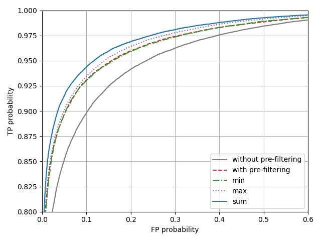

# Improving the robustness of digital watermark detection by combining detection methods

This repository contains Python scripts, C++ implementation of watermarks, and evaluation results used in the paper *"Improving the robustness of digital watermark detection by combining detection methods"*

The project investigates how the robustness of DCT-domain image watermark detection can be improved by combining multiple correlation-based detection methods using score-level fusion.

## Annotation

The paper addresses the issue of improving the robustness of DCT-domain digital image watermark detection by combining correlation-based detection methods. The detection method is treated as a classifier, and the correlation value is interpreted as a confidence score of the decision. Different approaches to combining detection methods through classifier score-level fusion, including summation, minimum and maximum selection are evaluated. Experiments conducted on an image dataset under a range of distortions showed that the highest level of detection robustness is achieved by summation.




## Repository Structure
```text
.
├── watermarks_implementation/   # C++ watermark implementation
├── watermarks/                  # Python wrappers of watermarks
├── images/                      # Input dataset
├── results/                     # Experimental results
├── test_watermarks.py           # Main experiment
├── combine_results.py           # Score fusion
├── plot.py                      # ROC plotting
└── README.md
```

## C++ Implementation of Watermark Used in the Article
The paper uses the following watermark:
**DCT-based watermark**, described in *"Cox I. J. et al. Secure Spread Spectrum Watermarking for Multimedia," IEEE Transactions on Image Processing, 1997, Vol. 6, No. 12, pp. 1673-1687.*

The source code of C++ implementation is available in the `watermarks_implementation` directory, along with build instructions in `README.md`.


## Python Scripts
For working with watermarks, Python wrappers located in the `watermark` directory are used. You need to update the paths to executables in the scripts found in this directory.

- **`config.py`**: describes watermarks, embedding strength, and distortion filters used in the experiment.
- **`test_watermarks.py`**: the script performs the main part of the experiment. It embeds watermarks into images from the `images` directory, applies filtering to the watermarked images to introduce distortions, calculates correlation values, and saves the results as `.csv` files.
- **`combine_results.py`**: this script combines the calculated correlation values from the .csv files created by `test_watermarks.py` using min, max, and summation, and produces output `.csv` files.
- **`plot.py`**: creates an ROC curve plot based on the results computed by `test_watermarks.py` and merged by `combine_results.py`.

## Evaluated Results
Evaluated results are stored in the `results` directory as `.csv` files.

## Reproducing the Experiment

1. Build C++ watermark executables.
2. Configure paths to watermark executables in watermark wrappers scripts in `watermarks/` directory.
3. Put test images into `images/`.
4. Run:

```bash
python3 test_watermarks.py #Can take up to a few hours on 8K images
python3 combine_results.py
python3 plot.py dct_watermark_0.5.csv dct_watermark_sharp_0.5.csv fusion_0.5_dct_watermark_dct_watermark_sharp_min.csv fusion_0.5_dct_watermark_dct_watermark_sharp_max.csv fusion_0.5_dct_watermark_dct_watermark_sharp_sum.csv
```